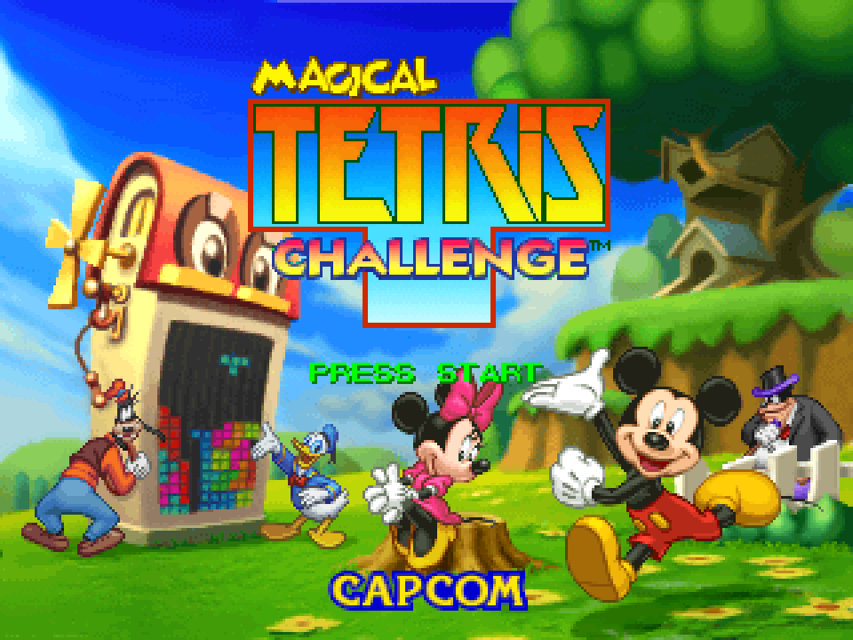

# Magical Tetris Challenge: Recompiled

A native PC port of **Magical Tetris Challenge** (Nintendo 64) created via static binary recompilation using the [N64Recomp](https://github.com/N64Recomp/N64Recomp) toolchain.



## Features

- **Native Linux Executable:** High-performance, low-latency native execution without traditional N64 CPU emulation overhead.
- **Vulkan Graphics Backend (RT64):** Enhanced rendering pipeline with custom fixes for Nintendo's S2DEX 2D sprite microcode (pixel-perfect background slicing and color-indexed rendering).
- **Accurate RSP Audio (RSPRecomp):** The game's custom audio microcode (`aspMain`) is statically translated into native C++, reproducing the original Capcom sound effects and soundtrack with zero HLE inaccuracies.
- **SDL2 Audio & Input:** Low-latency 48,000 Hz audio streaming with dynamic rate control, full gamepad support (SDL GameController), and keyboard mapping.

---

## Prerequisites (Linux)

Install the required build tools and libraries (Ubuntu/Debian example):

```bash
sudo apt update
sudo apt install build-essential cmake ninja-build libsdl2-dev libvulkan-dev vulkan-tools libgtk-3-dev
```

On Arch Linux:
```bash
sudo pacman -S base-devel cmake ninja sdl2 vulkan-headers vulkan-icd-loader gtk3
```

A Vulkan-compatible graphics driver (Mesa RADV, NVIDIA proprietary driver, or Intel ANV) is required.

---

## Building

1. **Clone the repository:**
   ```bash
   git clone https://github.com/depressobbq/mtc-decomp.git
   cd mtc-decomp
   ```

2. **Set up dependencies & build:**
   ```bash
   ./build.sh
   ```
   *`build.sh` automatically fetches `N64ModernRuntime` and `RT64` with submodules, applies project patches, and compiles the executable with Ninja.*

---

## Running

Place your legally acquired **Magical Tetris Challenge (USA)** ROM (`.z64`) in the project directory as `baserom.us.z64`, or place it in the `roms/` folder.

Launch the game:
```bash
./run.sh
```

---

## Controls

### Keyboard (Player 1)

| Action | Key |
| :--- | :--- |
| **D-Pad Up / Down / Left / Right** | Arrow Keys |
| **Analog Stick** | W / S / A / D |
| **A Button (Rotate Right)** | X / Space |
| **B Button (Rotate Left)** | C |
| **Z Trigger (Hard Drop)** | Z |
| **Start Button** | Enter |
| **L Trigger / R Trigger** | Q / E |
| **C-Buttons (Up / Down / Left / Right)** | I / K / J / L |
| **Fullscreen Toggle** | Alt + Enter |

### Gamepad

Directly supports any SDL2-compatible controller (Xbox, DualShock/DualSense, Switch Pro Controller, etc.) automatically mapped to the original N64 controller layout.

---

## Technical Details

- **S2DEX 2D Graphics Engine:** Fixed RT64 TMEM byte-stride calculations for `bgCopy` and TMEM height calculations for Color-Indexed (CI) textures. Added support for RDP `G_RDPNOOP` (opcode `0xC0`).
- **Audio Interface (AI) Rate Matching:** Emulates hardware DMA buffer pacing with a 2-VI headroom buffer, eliminating buffer underrun crackles and resampler pitch hunting.
- **RSP Audio Translation:** Audio commands are executed directly through C++ functions decompiled from the game's RSP binary using `RSPRecomp`.

---

## Credits

- **N64Recomp & RT64 Teams:** For the recompilation tools and modern graphics runtime.
- **Capcom & Disney:** Original game developers and publishers.
